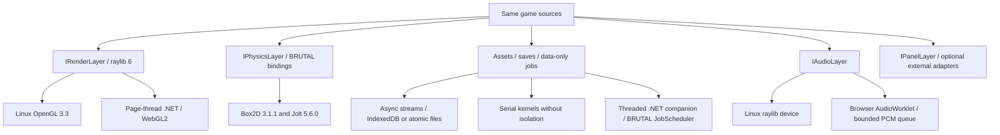

# brutal-web

[](https://github.com/finalbuildgames-com/brutal-web/blob/main/LICENSE)
[Source](https://github.com/finalbuildgames-com/brutal-web)

An extractable MIT host for upstream BRUTAL and raylib. **The same C# game** runs on Linux and Chrome: atlas sprites, text, glTF, cameras/shaders, Box2D/Jolt physics, audio, async assets, saves and jobs. Optional audio and panel adapters plug in through public interfaces.

## Quick start

Linux x86-64 prerequisites: Git, curl, Python 3.12+, CMake 3.25+, Ninja, flock, C/C++ compiler, X11/OpenGL development libraries, Node 18+ and Chrome. Scripts install no system packages. Exact user-local .NET/Emscripten/dependency pins are in [TOOLCHAIN.md](TOOLCHAIN.md).

```sh
git clone https://github.com/finalbuildgames-com/brutal-web.git
cd brutal-web
git clone https://github.com/ahwootech/BRUTAL.git upstream/brutal
git -C upstream/brutal checkout b30520d784f71bc3b3fa7907a75e985d6690e326
./bootstrap-toolchain.sh
./build-desktop.sh
./FinalBuild.Brutal.Desktop/bin/Release/net10.0/linux-x64/publish/FinalBuild.Brutal.Desktop
./build-web.sh
node serve.mjs                         # http://127.0.0.1:8127, serial jobs
# Or serve with COOP/COEP for worker jobs:
FBS_ISOLATE=1 node serve.mjs
npm ci
nice -n 19 node verify-browser.mjs
FBS_ISOLATE=1 nice -n 19 node verify-browser.mjs
```

The standalone source defaults to `upstream/brutal`; `BRUTAL_SOURCE` selects another checkout. The host compiles foundation, physics and concurrency bindings as source; only BRUTAL's interop analyzer comes from NuGet. No upstream files are edited, and no LFS assets are needed. Native archives download with pinned SHA-256 checks.

WASD/arrows move, Space plays sound, Escape pauses, wheel zooms, R resets the physics scene. Seven boxes in each engine topple after one second. Collect cells to autosave position/collection/mute state; a reload restores the whole record. The default HUD uses raylib; external adapters can provide other panel and audio implementations. All native uploads/drawing stay on the host frame thread.

Builds use nice 19, one MSBuild node and two native workers. Browser verification uses software SwiftShader, and build scripts lock their output tree.

## Architecture



**Bindings:** BRUTAL's LibraryImport pattern and UTF-8 marshaller with FBS C ABI shims. Desktop uses a DllImportResolver; wasm uses NativeFileReference archives and .NET's static PInvoke table. raylib structs never cross by value. BRUTAL's Box2D records have fixed x64 layouts: the shim converts pointer-bearing fields to the target's native layout rather than copying them into wasm32 structs. Selected Jolt vector/quaternion calls use pointer overlays. Public managed signatures remain the upstream signatures. The overlays live in build output, never the BRUTAL checkout.

The native physics adapter intentionally implements the **jam box-body subset**, listed in [native/ABI.md](native/ABI.md). Both engines are real native builds. Physics advances at fixed 1/60 steps on the frame thread; Jolt uses its single-thread job executor for this small scene. The generic job facade runs BRUTAL's managed scheduler on workers independently. Collision callbacks, joints, characters and arbitrary BRUTAL native entry points are not yet exposed by this host; call the layer's supported API.

## Jobs and SharedArrayBuffer

.NET 10's threaded runtime moves managed entry-point execution to a deputy worker and restricts synchronous exports from the page thread. raylib's GLFW/canvas host needs the page thread. The kit therefore keeps the renderer/game in the serial .NET runtime and, **only when `crossOriginIsolated` and SharedArrayBuffer are available**, loads a separate threaded .NET companion. Its async export runs BRUTAL JobScheduler on real ThreadPool workers and returns ordered data results. No canvas, physics handle, closure or mutable game object crosses runtimes.

`IJobLayer.RunAsync` accepts up to 64 named `JobRequest` records. Inputs are strings up to 64 KiB, results up to 1 MiB. Add kernels in a shared `partial JobKernels.Configure` implementation; templates include `game/GameJobs.cs`. Kernels are compiled for desktop, the serial browser fallback and the worker companion. Never use render/file/native handles inside a kernel. Desktop and workers execute the same kernel registry; the fallback executes them serially. The sample verifies equal checksums and real worker thread IDs.

Cancellation before submission prevents work. During a remote batch it stops awaiting results; already submitted kernels may finish. Kernels must be bounded and side-effect-free. Local kernels receive the cancellation token. No blocking Wait/Join/Monitor waits occur on the page thread. BRUTAL's thread-priority assignment is skipped for browser/normal-priority host jobs in a host overlay. The runtime's worker support remains experimental in .NET 10.

## Assets and persistence

`IAssetStore.OpenReadAsync` supplies a real incremental stream: FileStream on Linux, fetch ReadableStream readers in the browser. Reads are capped at 16 KiB per JS crossing. Dispose/cancellation aborts the fetch. `StageAsync` checks the manifest's size and SHA-256 before committing a native-readable file. Only startup assets stage before the game; the glTF model loads asynchronously after startup and uploads on a later frame. Large data can be processed directly from the stream without staging it all. Individual staged assets are bounded to 64 MiB and consume memory; this is not progressive texture decoding.

`ISaveStore` stores versioned, SHA-256-checked records (payload cap 1 MiB). IndexedDB commits one atomic transaction; desktop writes and flushes a unique temporary file, then atomically replaces the destination. Failures propagate. Missing saves return null; corrupt or unsupported records are rejected. Saves are namespaced by `game.json`'s unique ID. Desktop defaults to the user's local application-data directory under `FinalBuildGames/<id>`; `FBS_SAVE_DIR` selects a test/portable directory. The sample autosaves a validated whole-game record, not independent UI fragments. Storage can be unavailable or evicted by browser policy; export/cloud sync is outside this kit.

## AudioWorklet

A real first canvas key/pointer gesture creates/resumes AudioContext; there is no AudioContext beforehand. An AudioWorklet consumes stereo 48 kHz PCM in 128-frame quanta. Transferable 2048-frame chunks form a bounded queue (three chunks requested initially, approximately 128 ms), working both with and without SharedArrayBuffer. Native mixing happens on the page thread; the worklet only consumes PCM. Long page stalls can underrun the queue. No ScriptProcessor path is used. HTTPS or localhost is required.

The default audio adapter uses raylib's Wave decoder and bounded sample voices. External audio adapters can feed the same worklet through the native PCM callback seam.

## Jam template

```sh
./new-jam-game my-jam /path/to/my-jam
cd /path/to/my-jam
# Follow README.md to select/clone upstream BRUTAL, then:
./build-desktop.sh
./build-web.sh
```

The generator creates `game/` (all C# sources compiled for both hosts), `host/` (this public kit), build/run/serve wrappers and a unique save namespace. Optional `--adapter /external/path` copies that adapter **beside** the MIT host. Existing destinations are refused. The template includes rendering, HUD, sound, real physics and itch packaging, plus an example worker kernel.

## itch.io and self-hosting

`build-web.sh` packages both runtimes in `build/brutal-web-itch.zip`; `index.html` is at the root. It removes symbols/compression sidecars, validates the ZIP and writes `build/evidence/phase3-sizes.json` (`FBS_EVIDENCE_DIR` overrides). Upload to an HTML project, select “played in the browser”, allow keyboard focus, and use a 960×600 embed/fullscreen.

Enable itch.io's **SharedArrayBuffer support** for worker jobs. Leave it off for serial jobs; the same archive automatically selects the fallback. For self-hosting, worker mode needs `Cross-Origin-Opener-Policy: same-origin` and `Cross-Origin-Embedder-Policy: require-corp` on the page and compatible resource/iframe policies. `FBS_ISOLATE=1 node serve.mjs` demonstrates these headers.

Serve `.wasm` as `application/wasm`, `.js`/`.mjs` as `text/javascript`, and `.json` as `application/json`. URLs are relative for subdirectory hosting. The itch ZIP carries original files; the host supplies HTTP compression. SDK Brotli/gzip sidecars remain in `build/publish/wwwroot` for self-hosting: retain the original MIME type, send `Content-Encoding` and `Vary: Accept-Encoding`. Never rename compressed bytes to `.wasm` without the header. Size reports distinguish raw/gzip estimates, available Brotli sidecars and ZIP upload size; serial clients do not download the job companion.

## Reuse, extraction and updating

The host reuses BRUTAL's source bindings and JobScheduler, raylib's native/WebGL2 backends and audio decoding, and .NET's browser runtime/static native linking. Native shims normalize target ABI differences; optional adapters remain outside the host source tree.

MIT covers Final Build Games-authored kit code; BRUTAL keeps its attribution/branding license, raylib is zlib, and Box2D/Jolt are MIT. Full notices ship with desktop and web packages. See [NOTICE](NOTICE) for dependency credits.

Update upstream BRUTAL in its source checkout, pin the revision, review the source overlays/ABI subset and rebuild both hosts. Update native archive hashes deliberately and clear that dependency's old extracted build cache. Keep upstream source unmodified. Run the focused checks, CPU physics check, both Chrome modes and template smoke builds before publishing.

## STATUS and limits

Phase 3 adds real box physics, worker/serial jobs, async streaming, IndexedDB/file saves, AudioWorklet and project generation. Remaining scope: wider physics APIs/callbacks, parallel physics stepping, full glTF animation/PBR, progressive GPU uploads, cloud/export saves and direct wasm audio mixing in the worklet. Current graphics are WebGL2/OpenGL3.3, not Vulkan/WebGPU. wasm starts at 32 MiB and may grow toward a 2 GiB ceiling; decoded CPU/GPU assets and a worker runtime add memory. Mobile/Safari and hardware-GPU performance are not covered by the Linux Chrome software-rendered witness.

Focused checks: `~/.dotnet/dotnet run --project tests`; `./verify-desktop.sh` verifies Linux audio, physics and file persistence using Xvfb, pactl and parec; native CPU acceptance: `FinalBuild.Brutal.Desktop ... --physics-check` after building. Browser verification forbids ScriptProcessor, checks real PCM, physics toppling, worker/fallback results, streamed bytes, game/IndexedDB persistence after reload, UI/input, pixels, MIME and disposal. Verification output is written to ignored `build/evidence/`; `FBS_EVIDENCE_DIR` selects another output directory. Published size and timing figures are in [docs/measurements.md](docs/measurements.md).
